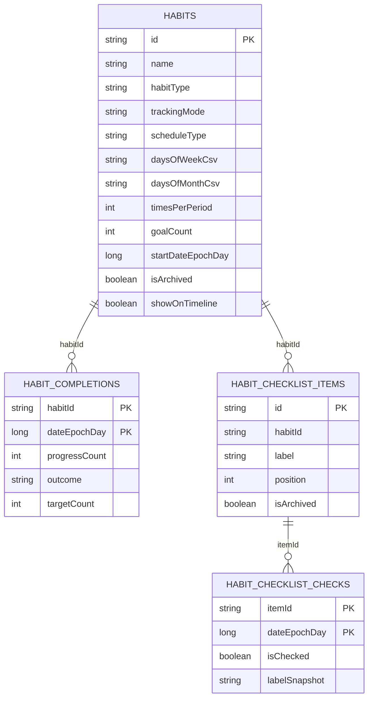

# 05 — Database

> Rewritten 2026-10-30 to match the checked-out code after the permanent Habits
> release. Earlier revisions of this document described schema v1, no
> migrations and an unencrypted database; all three statements were obsolete.

## Provider

**Room** (`androidx.room`, version 2.6.1) on top of **SQLCipher**
(`net.zetetic:sqlcipher-android:4.6.1`), i.e. an encrypted SQLite file in
app-private internal storage. There is no cloud/remote database and no network
dependency in the data layer.

- **File location on device**: internal app storage, filename `lifeos.db`
- **Schema version**: `7` (`AppDatabase.DATABASE_VERSION`)
- **Migrations**: explicit, forward-only, through `MIGRATION_1_2` …
  `MIGRATION_6_7`; `fallbackToDestructiveMigration` is **not** used, so a
  missing migration is a crash, never silent data loss.
- **Schema export**: `room.schemaLocation` is configured at the project KSP
  scope, so every version is committed under
  `app/schemas/com.lifeos.app.data.db.AppDatabase/<version>.json`
  (`1.json` … `7.json`). `AppDatabaseSchemaTest` parses `7.json` as the
  single source of truth for the current shape, and `MigrationTestHelper`
  uses the exported files in instrumentation tests.

### Migration history

| Migration | Version | Change |
|---|---|---|
| `MIGRATION_1_2` | 1 → 2 | Adds the single-column indexes the hot day/range queries scan. |
| `MIGRATION_2_3` | 2 → 3 | Drops the removed Notes/Captures tables; every retained table is untouched. |
| `MIGRATION_3_4` | 3 → 4 | Adds the `reminders` table + indexes. |
| `MIGRATION_4_5` | 4 → 5 | Adds `diary_entries.isFavorite` (`NOT NULL DEFAULT 0`). |
| `MIGRATION_5_6` | 5 → 6 | Re-adds `notes`, `note_folders`, `captures`. |
| `MIGRATION_6_7` | 6 → 7 | The permanent Habits model: new `habits` columns, `habit_completions.outcome` + `targetCount`, and the two checklist tables. |

`MIGRATION_6_7` is purely additive over populated data. Existing
DAILY/WEEKLY/CUSTOM habits keep their exact pre-v7 meaning through
`HabitScheduleType.LEGACY`; a v6 completion reads back as `outcome = DONE`
with `targetCount = 0` ("use the habit's current goal"). These properties are
asserted by `AppDatabaseMigrationTest.migrate6To7_*`.

## Tables (entities)

Eleven active tables:
`tasks`, `habits`, `habit_completions`, `habit_checklist_items`,
`habit_checklist_checks`, `expenses`, `diary_entries`, `reminders`, `notes`,
`note_folders`, `captures`.

The exported `7.json` is authoritative for exact SQL. The tables changed by
the permanent Habits release are documented in full below.

### `habits` — `data/db/entities/HabitEntity.kt`

| Field | Type | Notes |
|---|---|---|
| id | String (PK) | |
| name | String | |
| icon | String | emoji, chosen from the local icon grid |
| category | String? | one of the local `habitCategoryOptions` (free text tolerated) |
| frequency | enum HabitFrequency | DAILY / WEEKLY / CUSTOM — pre-v7 mirror |
| customDaysCsv | String? | pre-v7 weekday CSV (ISO numbers or names) |
| goalCount | Int | target for COUNT tracking; ≥ 1 |
| reminderEpochMillis | Long? | mirror driving the reminder reconciliation |
| startDateEpochDay | Long | habits never count before this day |
| isArchived | Boolean | archived habits keep all history and are restorable |
| createdAt / updatedAt | Long | epoch millis |
| description | String? | optional "why" |
| colorArgb | Long | ARGB; `0` means "use the scoped Habit Iris default" |
| habitType | enum HabitType | BUILD or QUIT |
| trackingMode | enum HabitTrackingMode | TICK / COUNT / CHECKLIST |
| scheduleType | enum HabitScheduleType | LEGACY / EVERY_DAY / WEEKDAYS / MONTH_DAYS / TIMES_PER_WEEK / TIMES_PER_MONTH |
| daysOfWeekCsv | String? | ISO weekdays (1=Mon..7=Sun) for WEEKDAYS |
| daysOfMonthCsv | String? | days 1..31 for MONTH_DAYS |
| timesPerPeriod | Int? | target for TIMES_PER_WEEK / TIMES_PER_MONTH |
| showOnTimeline | Boolean | successful days may appear on the Life Timeline |

There is **no** "missed" flag on the habit itself: an unrecorded scheduled day
is derived, never stored, so a blank day can never be rewritten as a failure.

### `habit_completions` — `data/db/entities/HabitEntity.kt`

Composite primary key: **(`habitId`, `dateEpochDay`)** — one row per habit per
day. No row means "not recorded", which is deliberately different from both
DONE and SLIPPED.

| Field | Type | Notes |
|---|---|---|
| habitId | String | FK by convention (no `@ForeignKey` declared) |
| dateEpochDay | Long | |
| progressCount | Int | ticks/counts/checked items on that day |
| completedAtEpochMillis | Long | last write time |
| outcome | enum HabitOutcome | DONE or SLIPPED (explicit, never inferred) |
| targetCount | Int | snapshot of the target on that day; `0` = legacy row, use the habit's current target |

### `habit_checklist_items` — the reusable template

| Field | Type | Notes |
|---|---|---|
| id | String (PK) | stable across edits |
| habitId | String | |
| label | String | |
| position | Int | display order |
| isArchived | Boolean | removed items are archived, never deleted while checks exist |
| createdAt | Long | |

### `habit_checklist_checks` — the per-date answers

Composite primary key: **(`itemId`, `dateEpochDay`)**.

| Field | Type | Notes |
|---|---|---|
| itemId | String | |
| habitId | String | |
| dateEpochDay | Long | |
| isChecked | Boolean | |
| checkedAtEpochMillis | Long | |
| labelSnapshot | String | the label when it was checked, so renames never rewrite history |

A day's checklist completion (`habit_completions`) is reconciled from these
rows: it is cleared while nothing is checked and its `targetCount` snapshots
the number of active items, so later template edits cannot change the past.

### Other tables

`tasks`, `expenses`, `diary_entries`, `reminders`, `notes`, `note_folders`
and `captures` keep their existing shapes. For their exact column lists see
the exported schema `app/schemas/com.lifeos.app.data.db.AppDatabase/7.json`
(and `AppDatabaseSchemaTest`, which asserts the persisted columns for
reminders, diary, notes, folders and captures).

## Relationships

There are **no formal `@ForeignKey` constraints** declared. Referential
integrity is enforced by the repositories:

- `HabitRepository.delete(id)` deletes the habit's completions, checklist
  checks, checklist items and reminder row together with the habit.
- Archiving keeps every row and only flips `isArchived`; restoring re-syncs
  the reminder.
- `TaskEntity.sourceId` loosely references a note/diary entry.

## Indexes

Entities declare the indexes their hot queries need; Room exports them in the
schema JSON. The permanent Habits release adds:

- `index_habit_checklist_items_habitId`
- `index_habit_checklist_items_habitId_position`
- `index_habit_checklist_checks_habitId`
- `index_habit_checklist_checks_habitId_dateEpochDay`

plus the pre-existing `index_habits_isArchived` and
`index_habit_completions_dateEpochDay`.

## Security rules

- The database file is encrypted with **SQLCipher**. The passphrase is random
  per install and wrapped by an Android Keystore AES-GCM key
  (`core/security/DatabasePassphraseProvider`); a missing/corrupt key surfaces
  `DatabaseKeyUnavailableException` as a recovery screen instead of a crash.
- `android:allowBackup="false"` and data-extraction rules keep the file out of
  OS auto-backup.
- App Lock is a PIN gate over the UI; SQLCipher is what protects the bytes at
  rest. Nothing is uploaded anywhere.
- Exported JSON is an explicit, user-initiated action (SAF share), never an
  automatic sync.

## Backup format

`data/repository/BackupRepository.kt` exports one JSON file containing every
active table. `LifeOSBackup.CURRENT_FORMAT_VERSION` is **2**:

- v2 adds `habitChecklistItems` and `habitChecklistChecks`; the new habit
  fields travel inside the serialized `HabitEntity` rows with defaults.
- v1 files still decode and restore with empty checklist defaults
  (`ignoreUnknownKeys` + field defaults).
- Files from a newer format version are rejected with a clear message.
- Restore is idempotent (upsert by primary key) and rebuilds the reminder
  table/alarms from the restored mirrors afterwards.

## Read/write operations

All reads/writes go through DAO interfaces in `data/db/dao/`, wrapped by
repositories in `data/repository/`. DAOs expose `suspend fun` for one-shot
work and `Flow<T>` for reactive reads that Compose collects.

## Data lifecycle

- **Habits**: archived (`isArchived = true`, restorable) or hard-deleted
  (habit + completions + checklist rows + reminder).
- **Notes/Tasks**: soft-deleted first; notes can be restored from Trash.
- **Expenses, Diary, Captures**: hard-deleted.
- **Backup**: versioned JSON export/restore described above.

## Diagram

No production database credentials or connection strings exist anywhere in
this repository — there is no remote database.
